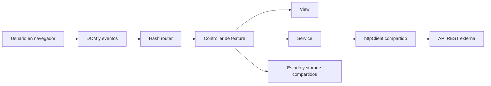
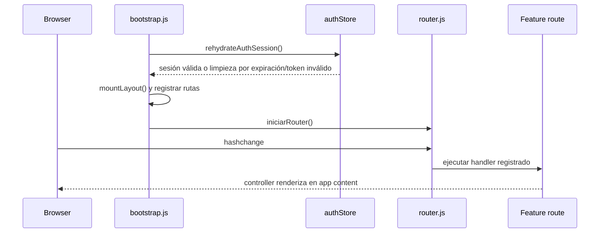
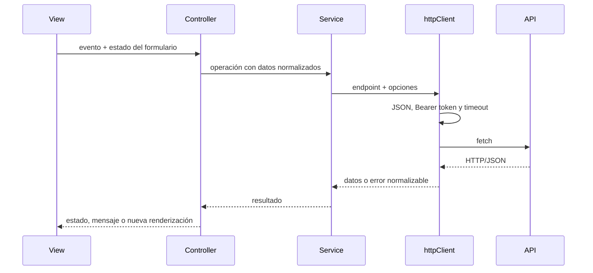

# Arquitectura frontend vigente

El frontend implementa una SPA en Vanilla JavaScript organizada por funcionalidades, con límites Controller/View/Service de estilo MVC. No existen puertos y adaptadores formales suficientes para describirla como Clean Architecture o Hexagonal estricta.

## Vista de contexto



El navegador, este repositorio frontend y la API son límites diferentes. La interfaz puede impedir selecciones inválidas y representar errores, pero la persistencia, la autorización definitiva y las garantías transaccionales pertenecen a la API.

## Decisiones arquitectónicas observadas

| Decisión | Implementación | Consecuencia |
|---|---|---|
| Modularidad por feature | `src/features/<feature>/` | Cada área agrupa rutas, controller, view, service, constantes y mappers cuando aplican. |
| Composición central | `src/app/bootstrap.js` importa las rutas | El bootstrap monta layout, registra rutas base y arranca el router. |
| Hash routing | `src/shared/router/router.js` | La navegación usa `#/ruta`, `window.location.hash` y `hashchange`; no usa History API. |
| HTTP compartido | `src/shared/services/httpClient.js` | Centraliza base URL, timeout, JSON, JWT, `fetch` y fallos de transporte/HTTP. |
| Estado de autenticación compartido | `src/shared/state/authStore.js` y `src/shared/storage/authTokenStorage.js` | Rehidrata JWT, rol, expiración y estado MFA desde `localStorage`. |
| Adaptación de contratos | Mappers compartidos y por feature | Reduce el acoplamiento de views y controllers a variaciones del JSON. |
| Estilos globales + locales | `src/shared/styles/` y CSS por feature | Conserva tokens comunes y encapsulación conceptual mediante BEM. |

## Flujo de arranque y navegación



1. `initializeApp()` captura el token existente y rehidrata la sesión.
2. Si había token y la rehidratación lo invalida, navega a `#/auth`.
3. Monta el layout y configura un handler global para respuestas `401`/`403`.
4. Registra `/dashboard`, `/404` y las rutas publicadas en `window.appFeatureRoutes`.
5. El router normaliza el hash y ejecuta el renderizador asociado.

## Flujo de solicitud API



En servicios, `readServicesFormState(...)` mantiene la lectura del formulario dentro de la View. Esta regla evita que el Controller haga scraping directo del DOM.

## Rutas y protección observada

| Ruta | Módulo | Protección comprobada |
|---|---|---|
| `/`, `/auth` | auth | Entrada y autenticación. |
| `/dashboard` | bootstrap | Sin guarda local; contenido placeholder. |
| `/citas` | citas | No comprueba sesión en su módulo de rutas. |
| `/clientes` | clientes | No comprueba sesión en su módulo de rutas. |
| `/empleados` | empleados | Comprueba rol `OWNER`. |
| `/servicios` | servicios | Comprueba rol `OWNER`. |
| `/recursos` | recursos | Comprueba rol `OWNER`. |
| `/usuarios` | usuarios | Comprueba rol `OWNER`. |
| `/mfa-setup` | mfa | Valida sesión, expiración, token malformado y MFA ya activo. |
| `/user-settings` | user-settings | No comprueba sesión en su módulo de rutas. |
| `/404` | bootstrap | Fallback del router. |

No existe una guarda global uniforme para cada transición. El handler HTTP de `401`/`403` limpia la sesión y redirige, pero actúa después de una respuesta de API; no sustituye la autorización del backend ni una guarda preventiva.

## Límites de estado y seguridad

- El JWT se guarda en `localStorage`; el navegador decodifica el payload y revisa `exp`, pero no verifica la firma.
- Los claims de rol se normalizan desde distintas formas; MFA acepta `mfa_enabled`, `mfaEnabled`, `mfaActivo` y `mfa` por compatibilidad.
- El secreto MFA se conserva temporalmente en estado del controller y se limpia al completar o cancelar.
- `httpClient` agrega `Authorization: Bearer <token>` cuando existe token y dispara el callback global para `401`/`403` salvo exclusión explícita.
- Existen helpers de escape HTML compartidos y locales, pero no se ha realizado una auditoría completa de sinks DOM.

Consulte [Autenticación y MFA](../seguridad/autenticacion-y-mfa.md) para el flujo detallado.

## Módulos y dependencias

```text
app/bootstrap
  ├─> feature routes
  │    └─> controller ─> view
  │                   └─> service ─> shared/httpClient
  ├─> shared/router
  ├─> shared/components/layout
  └─> shared/state/authStore ─> shared/storage
```

Las features pueden consumir catálogos mediante endpoints sin importar otras features. Por ejemplo, empleados consulta servicios y servicios consulta recursos; esto mantiene la dependencia en el contrato HTTP en vez de acoplar controllers entre sí.

## Restricciones y deuda conocida

- La URL `http://localhost:8080` está codificada y no existe configuración por ambiente.
- El código actual no demuestra HTTPS en desarrollo ni una política productiva.
- El dashboard y sus métricas no están implementados.
- La migración del JWT a cookies `httpOnly` está pendiente de una decisión de despliegue y coordinación con backend.
- Citas mantiene compatibilidad temporal entre clases BEM `citas*` y `appointments*`.
- La garantía de no overbooking requiere validación atómica del backend, aun cuando el frontend consulte franjas y bloquee opciones.

## Referencias

- [Análisis y requisitos](../analisis/analisis-y-requisitos.md)
- [Estructura del proyecto](../desarrollo/estructura-del-proyecto.md)
- [Integración API](../api/integracion-api.md)
- [Convenciones](../desarrollo/convenciones.md)