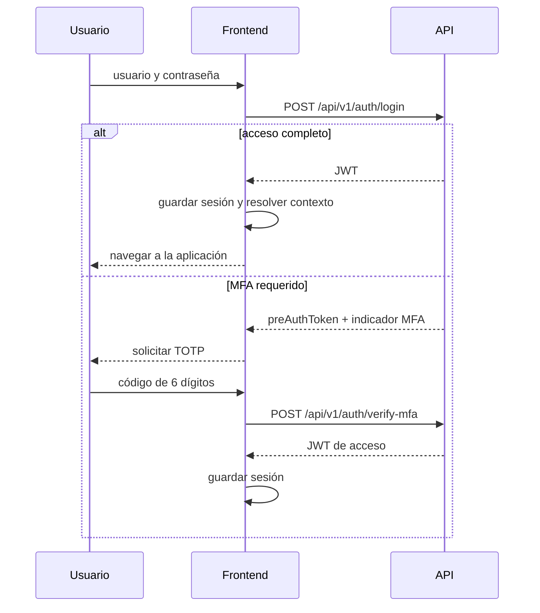

# Autenticación, sesión y MFA

El frontend implementa login con JWT, verificación MFA durante el acceso y aprovisionamiento TOTP mediante QR. La sesión se almacena actualmente en `localStorage`; las cookies `httpOnly`, refresh tokens y una política HTTPS definitiva son decisiones pendientes, no capacidades implementadas.

## Componentes

| Componente | Responsabilidad comprobada |
|---|---|
| `features/auth` | Login, verificación MFA y registro de credenciales de empleado. |
| `features/mfa` | Solicitud de setup QR y confirmación del primer TOTP. |
| `features/user-settings` | Entrada de UI al flujo MFA; otros ajustes están previstos. |
| `shared/state/authStore.js` | Contexto de sesión, decodificación de payload, expiración, rol y MFA. |
| `shared/storage/authTokenStorage.js` | Lectura, escritura y eliminación del JWT en `localStorage`. |
| `shared/services/httpClient.js` | Bearer token y callback global para `401`/`403`. |

## Login sin y con MFA



El payload de verificación se construye con `preAuthToken`, `totpCode` y, cuando está disponible, `nombreUsuario`. La API emite y valida los tokens; el navegador no valida criptográficamente la firma JWT.

## Rehidratación de sesión

Al iniciar la aplicación:

1. Se lee el JWT de `localStorage`.
2. Se comprueba que tenga tres segmentos y que el payload pueda decodificarse.
3. Se revisa `exp`; una sesión expirada o malformada se limpia.
4. Se normalizan claims de rol y estado MFA.
5. Si existía token antes de rehidratar y queda invalidado, se navega a `#/auth`.

La normalización de rol acepta formas como `rol`, `role`, `roles` y `authorities`. El indicador MFA admite `mfa_enabled`, `mfaEnabled`, `mfaActivo` y `mfa`; `mfa_enabled` está cubierto por una prueba de integración.

## Aprovisionamiento MFA

```mermaid
sequenceDiagram
    participant U as Usuario autenticado
    participant F as Frontend
    participant A as API
    U->>F: abrir configuración MFA
    F->>A: GET /api/v1/usuarios/me/mfa/setup
    A-->>F: secret + qrCodeUrl
    F-->>U: mostrar QR y pedir TOTP
    U->>F: código de 6 dígitos
    F->>A: POST /api/v1/usuarios/me/mfa/enable {secret, code}
    A-->>F: éxito; posible token rotado
    F->>F: actualizar token si existe y limpiar secret temporal
```

### Reglas de interfaz comprobadas

- La ruta `/mfa-setup` exige sesión válida, rechaza token expirado o malformado y evita reprovisionar cuando el claim indica MFA activo.
- El código TOTP debe tener exactamente seis dígitos antes de enviarse.
- El `secret` se mantiene en estado del controller durante el flujo y se limpia al completar o cancelar; no se guarda en `localStorage`.
- El QR se recibe como `qrCodeUrl` y se muestra para una aplicación TOTP compatible.
- Errores `400`, `403`, `404` y `500` tienen mensajes diferenciados y permiten los flujos de reintento previstos por la UI.

### Contrato pendiente

La especificación anterior indicaba `204 No Content` al habilitar MFA. El controller actual acepta una respuesta con `{ token }` y reemplaza el JWT cuando está presente. Backend y frontend deben acordar una de estas variantes, especialmente si activar MFA cambia los claims del token.

## Guardas y autorización

| Área | Estado |
|---|---|
| MFA setup | Guarda local completa para sesión, expiración, formato y MFA activo. |
| Empleados, servicios, recursos y usuarios | Guardas locales de rol `OWNER`. |
| Citas, clientes y user settings | Los módulos de rutas no comprueban sesión. |
| Respuestas `401`/`403` | El handler global limpia sesión y navega a `/auth`, salvo solicitudes que lo omitan. |
| Backend | Debe autorizar todas las operaciones independientemente de la UI. |

La ausencia de una guarda uniforme es una limitación actual. Una ruta visible u oculta nunca reemplaza controles de autorización en la API.

## Almacenamiento y riesgos

| Decisión vigente | Riesgo / límite | Trabajo futuro |
|---|---|---|
| JWT en `localStorage` | Un XSS exitoso podría acceder al token. | Evaluar cookies `httpOnly`, `Secure` y `SameSite` con el backend. |
| Decodificación local del JWT | Solo permite leer claims; no prueba autenticidad. | Mantener al backend como autoridad y evitar decisiones irreversibles solo por claims de UI. |
| Host API por HTTP local | No protege datos en tránsito fuera de un entorno controlado. | Definir HTTPS según despliegue. |
| Sin refresh token documentado | La renovación de sesión no está especificada. | Diseñar expiración y renovación si el producto lo requiere. |
| Sin códigos de recuperación | La recuperación MFA no está cubierta. | Analizar desactivación segura, recovery codes y soporte operativo. |

## Restricciones de seguridad

- No registrar contraseñas, JWT, pre-auth tokens, secretos MFA ni códigos TOTP.
- No persistir el secreto MFA en almacenamiento del navegador.
- Escapar contenido dinámico; la existencia de helpers no demuestra cobertura total contra XSS.
- Tratar `401`/`403` como fallos de acceso y no como errores recuperables silenciosamente.
- Usar HTTPS en un despliegue real que transporte credenciales o datos personales.
- Validar en backend todos los roles, tokens, códigos y reglas de negocio.
- Proteger datos personales conforme a la Ley 1581 de 2012; cifrado, retención y backups no se verifican en este frontend.

## Decisiones diferidas

1. Entorno final: intranet controlada, dominio público o cloud.
2. Cookies `httpOnly` frente a almacenamiento actual y protección CSRF asociada.
3. Refresh token, cierre de todas las sesiones y revocación.
4. Recuperación y desactivación de MFA.
5. Contrato de token rotado al habilitar MFA.
6. Guarda global uniforme para rutas autenticadas.

Contratos: [Integración API](../api/integracion-api.md). Requisitos: [Análisis y requisitos](../analisis/analisis-y-requisitos.md).